# WhatsApp Sales and Quotation Assistant

I built **QuoteFlow** as a WhatsApp-style sales and quotation assistant to help businesses handle customer product enquiries and prepare quotations faster through a WhatsApp-style conversation.. It simulates a customer asking about products, captures the quantity they need, checks a local catalogue and stock, calculates a quotation, and saves it after the customer confirms. It is a local demonstration application; it does not connect to WhatsApp or send messages to real customers.

## Preview

The screenshots below were captured from the running application using a separate local demo database and fictional sender IDs.

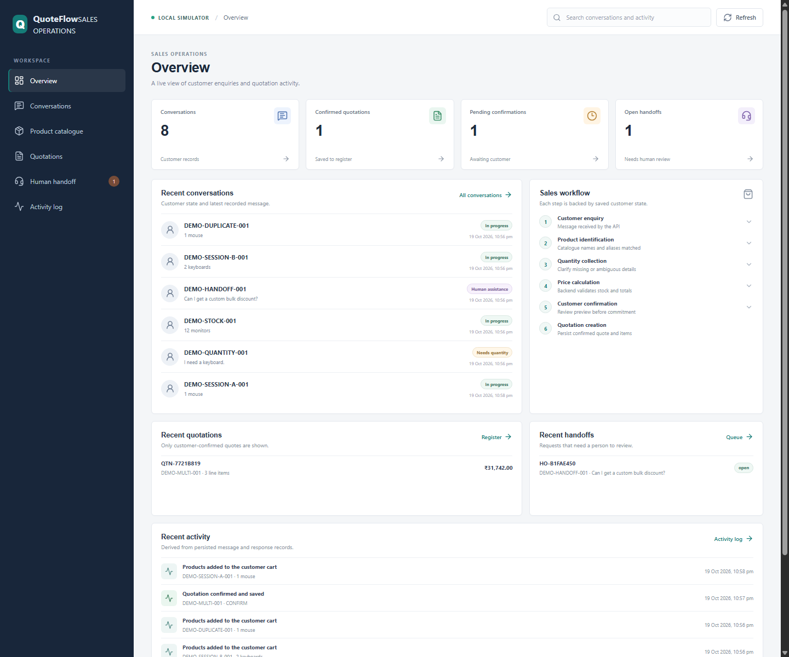

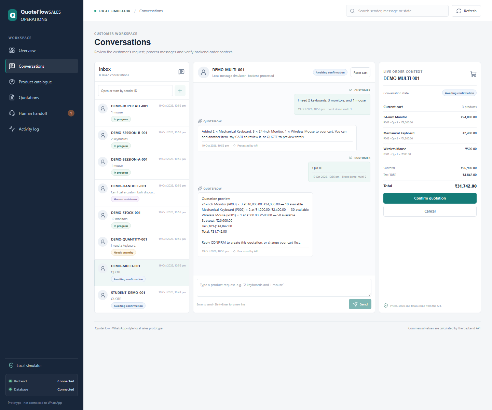

## Contents

- [Problem and objectives](#problem-and-objectives)
- [Technology stack](#technology-stack)
- [Implemented features](#implemented-features)
- [Screenshots and walkthrough](#screenshots-and-walkthrough)
- [End-to-end workflow](#end-to-end-workflow)
- [Architecture and data storage](#architecture-and-data-storage)
- [Installation and local execution](#installation-and-local-execution)
- [Demonstration scenarios](#demonstration-scenarios)
- [Testing evidence](#testing-evidence)
- [Limitations and future improvements](#limitations-and-future-improvements)
- [Deployment design](#deployment-design)
- [Conclusion](#conclusion)

## Problem and objectives

Product enquiries often require several small steps before a sales representative can prepare a useful quotation: identify the catalogue item, clarify the quantity, check stock, calculate the price, and confirm the customer's intent. Handling these steps manually can lead to inconsistent totals or incomplete requests.

I built this project to demonstrate how that routine flow can be handled through a WhatsApp-style message interface. The application keeps each sender's conversation and cart separate, so a quantity clarification or quote for one customer does not change another customer's order. Product names, prices, and stock come from the backend catalogue, and the backend calculates totals rather than trusting values from the browser. A quotation is saved only after a customer confirms its preview.

## Technology stack

| Area | Technologies |
|---|---|
| Frontend | React 18, Vite 6, JavaScript ES modules, CSS, Lucide React |
| Backend | Node.js, Express 4, Zod request validation, Pino logging, Helmet, CORS |
| Product matching | Deterministic local intent and quantity parsing, catalogue name/alias/ID matching, Fuse.js fuzzy matching |
| Database | SQLite using `better-sqlite3`; versioned migrations, transactions, WAL mode, and foreign keys |
| Tests | Node.js built-in test runner (`node:test`), assertions, and HTTP requests against an ephemeral server |
| CI | GitHub Actions workflow runs the backend tests and frontend production build on pushes and pull requests |

There is no external language-model service, WhatsApp API, or API key in the current application.

## Implemented features

- Six connected work areas: Overview, Conversations, Product Catalogue, Quotations, Human Handoff, and Activity Log.
- A seeded 12-item product catalogue with product IDs, descriptions, aliases, prices, and stock.
- Product lookup using catalogue IDs, names, aliases, and fuzzy matching. The local parser handles common English and some Hinglish requests; it is not a general-purpose conversational model.
- A customer-specific conversation and cart, including clarification when a product is named without a quantity.
- Whole-number quantity validation and stock checks. A request above the available stock is rejected instead of being added to the cart.
- Backend calculation of item totals, subtotal, tax, and quotation total. The default tax rate is configurable and is 18%.
- A quotation preview and explicit confirmation step. The quotation and its item/price snapshots are persisted after confirmation.
- Duplicate-event protection: an identical message ID and payload returns the previously saved response without repeating its effects. Reusing an ID with a different payload returns an HTTP 409 conflict.
- A local human-review queue for supported handoff requests, with status updates and a status history. The queue does not contact an employee.
- An activity log reconstructed from saved messages and processing responses.
- A local message simulator in the browser. It sends events to the backend webhook; it is not a live WhatsApp integration.

## Screenshots and walkthrough

All images in this section were captured from the running frontend connected to the local API. The demo used fictional sender IDs and an isolated SQLite database, not personal customer information.

### Overview dashboard


I opened the overview after starting both services. It displays values returned from the database, including saved conversations, confirmed quotations, pending confirmations, and open handoffs. The recent conversation, quotation, handoff, and activity panels show how the work areas reflect persisted records rather than static sample cards.

### Conversation workspace


I selected the demo customer in Conversations. The page shows the inbox, saved message transcript, and live order context together. The conversation was processed by the backend and the customer's current cart is kept separate from other senders.

### Multi-product quotation preview


To exercise the quote calculation, I sent `I need 2 keyboards, 3 monitors, and 1 mouse.` and then `QUOTE`. The preview contains two Mechanical Keyboards, three 24-inch Monitors, and one Wireless Mouse. At the default 18% tax rate, the backend calculated a subtotal of ₹26,900.00, tax of ₹4,842.00, and total of ₹31,742.00. This is a preview; it is not yet a saved quotation.

### Missing quantity clarification

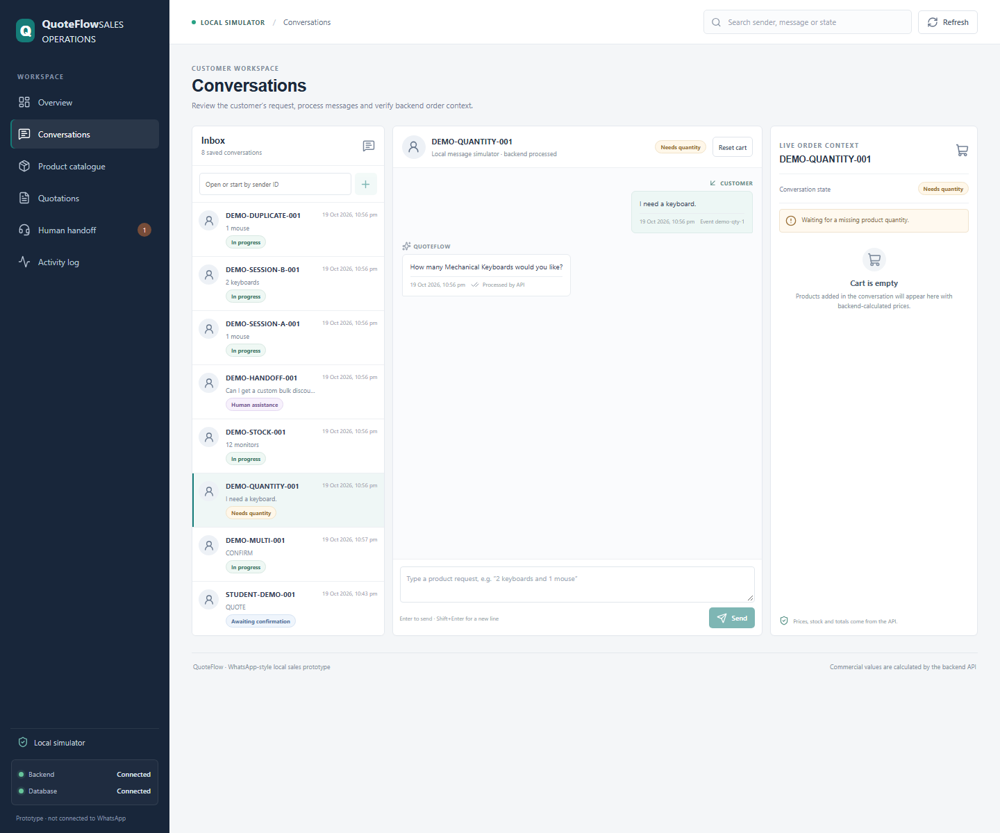

I sent `I need a keyboard.` without a quantity. The assistant asked how many Mechanical Keyboards I wanted, and the conversation entered a “Needs quantity” state. No product was added to the cart before the question was answered.

### Insufficient stock

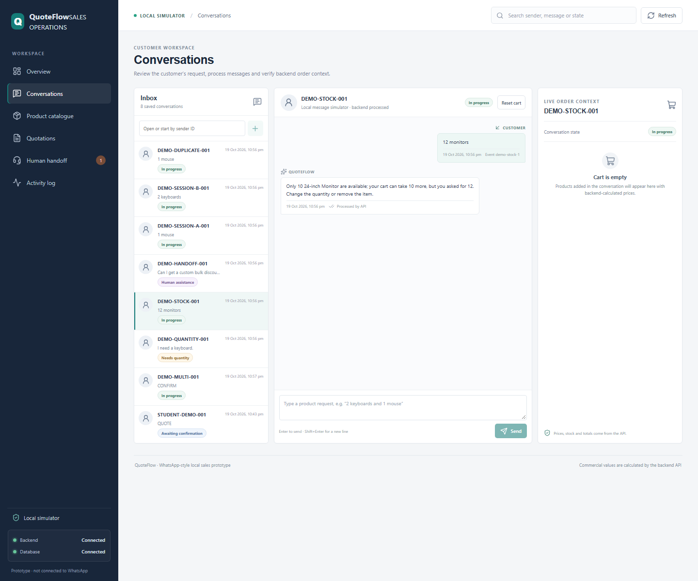

I requested `12 monitors`. The catalogue has 10 24-inch Monitors available, so the assistant reported the limit and did not add the request to the cart.

### Quotation confirmation

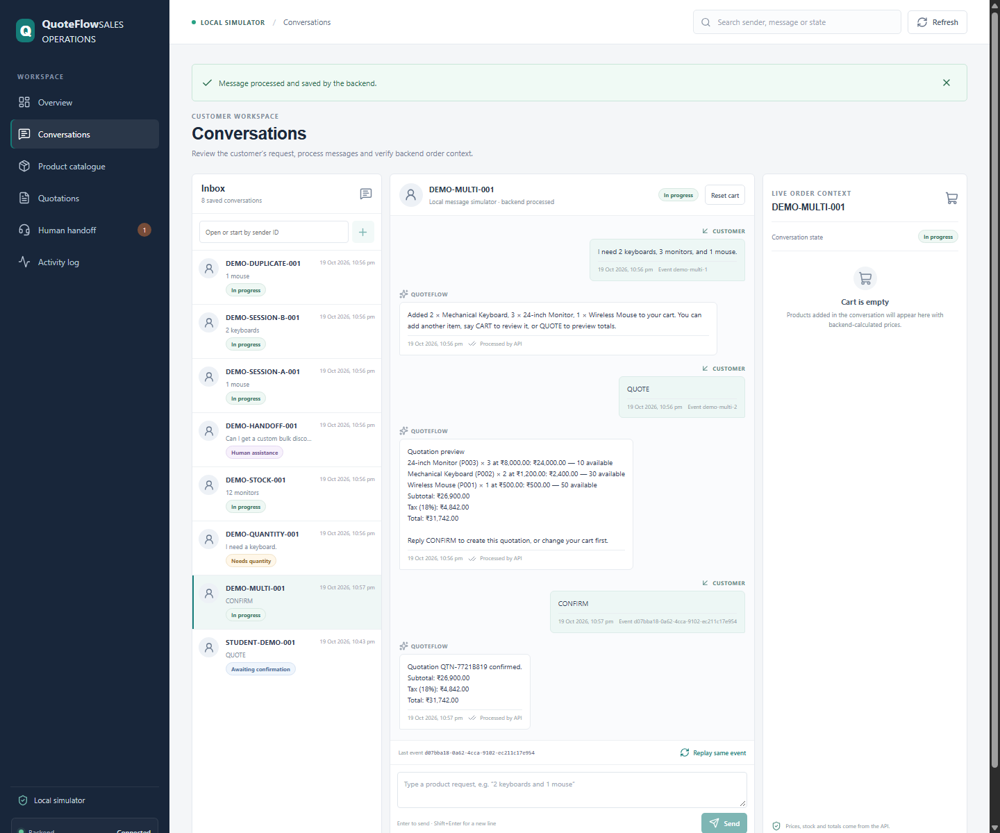

After reviewing the multi-product preview, I selected **Confirm quotation**. The assistant returned a quotation ID and the same subtotal, tax, and total. The cart was cleared after confirmation while the saved quotation remained in the register.

### Quotation register

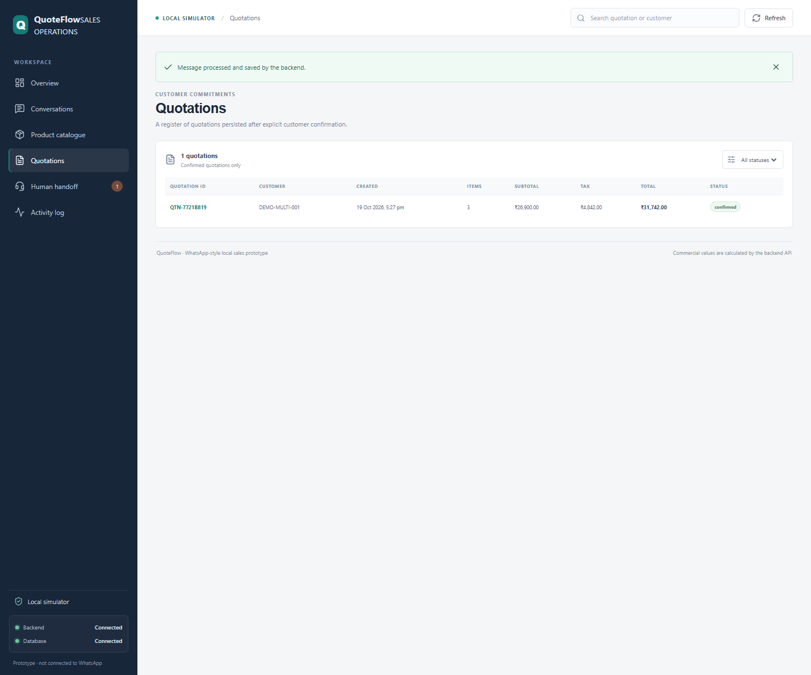

I opened Quotations after confirming the preview. The register contains the persisted quote, customer ID, number of items, financial totals, and confirmed status. A preview alone does not create a register entry.

### Human handoff conversation

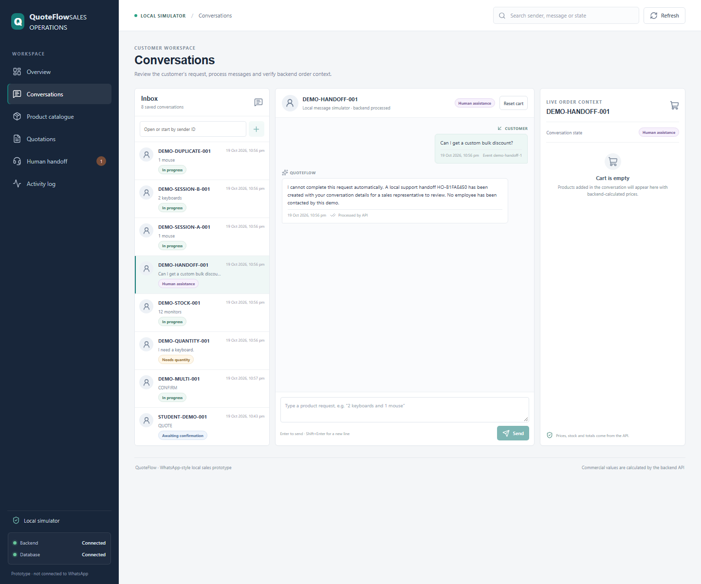

I sent `Can I get a custom bulk discount?`. The assistant created a local handoff record and explicitly explained that no employee was contacted. The request is then available in the staff-facing review queue.

### Human handoff queue

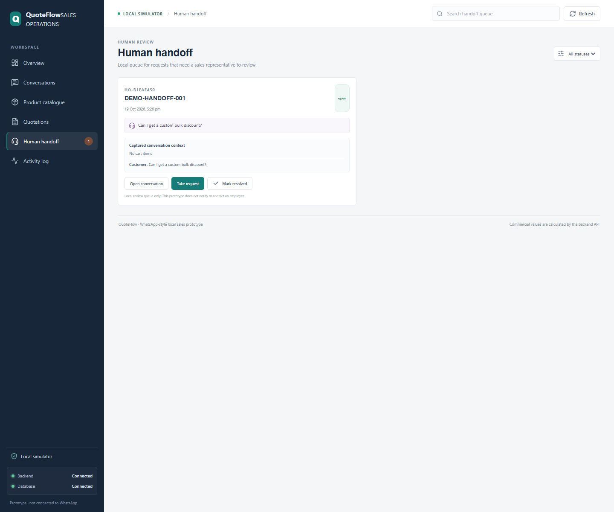

The Human Handoff page shows the saved request and its context for local review. Queue status can be changed in the interface; those changes are recorded in the handoff status history.

### Independent customer sessions

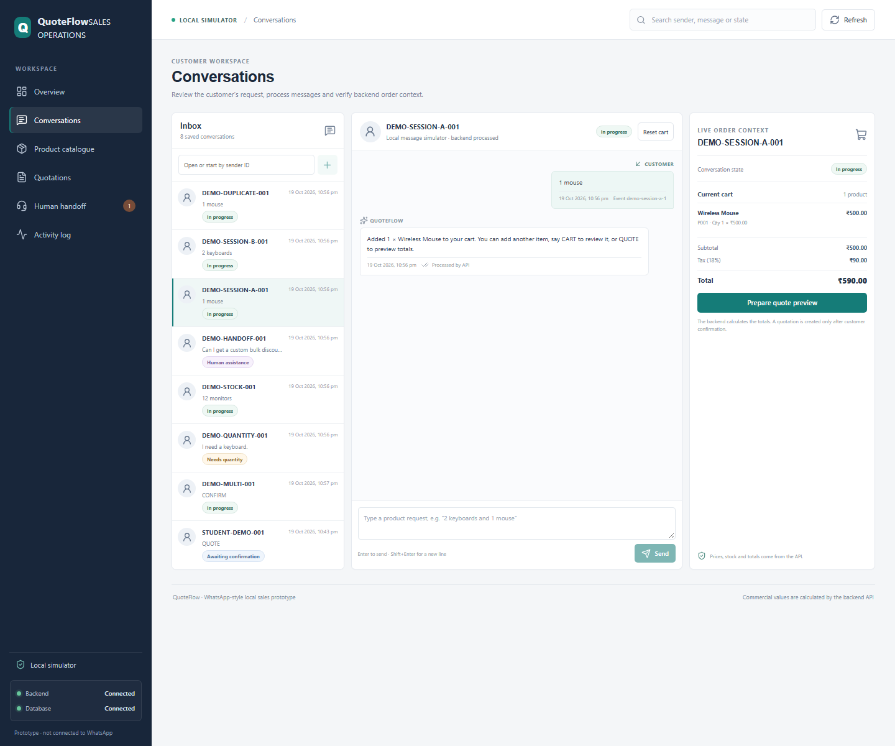

I created one session with a Wireless Mouse and a second session with Mechanical Keyboards. Selecting one sender shows that sender's own conversation and cart, while the other sender remains a separate inbox entry.

### Duplicate event handling

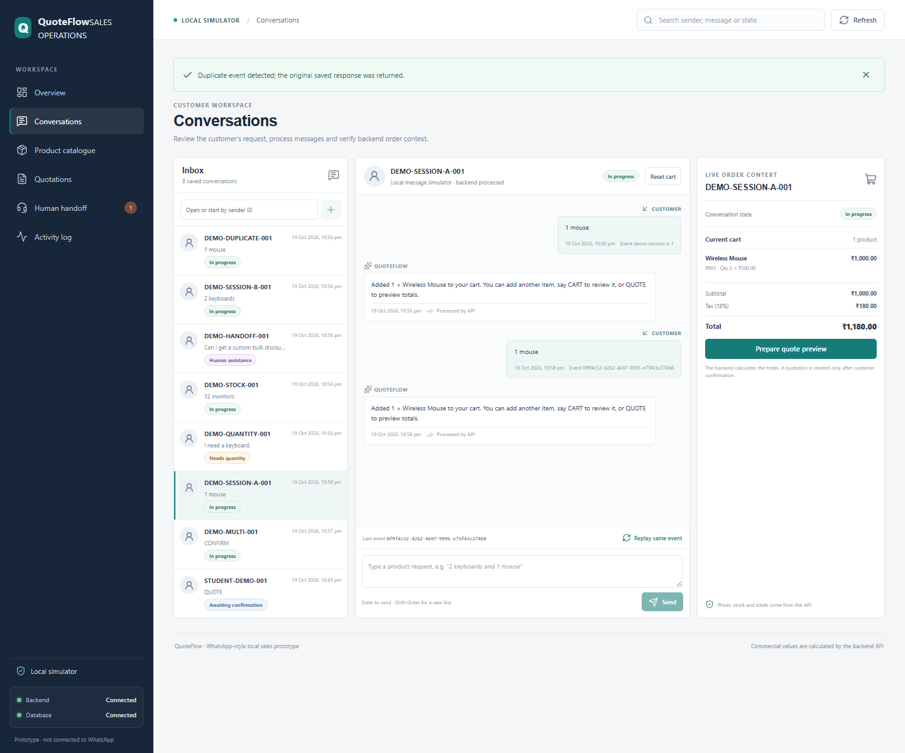

I sent a message in the conversation workspace and used **Replay same event**. The UI reported that it returned the saved response. The cart shows the effect of the original message only; replaying the same event did not add the item a second time.

### Product catalogue

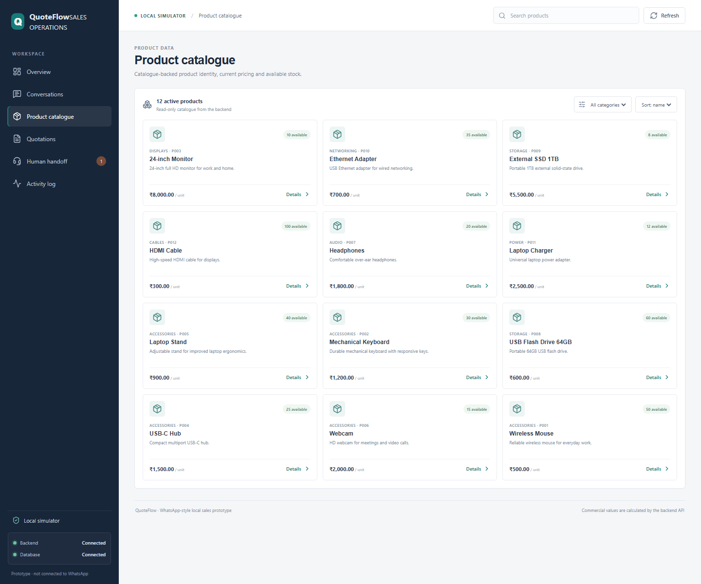

The catalogue page displays the active products, their IDs, descriptions, prices, and available stock as read from the backend.

## End-to-end workflow

In the local demonstration, a customer message is sent to the backend by the browser's message simulator. Product identification and quantity handling happen locally in the sales workflow code. A quote is saved only after the customer reviews and confirms the preview.

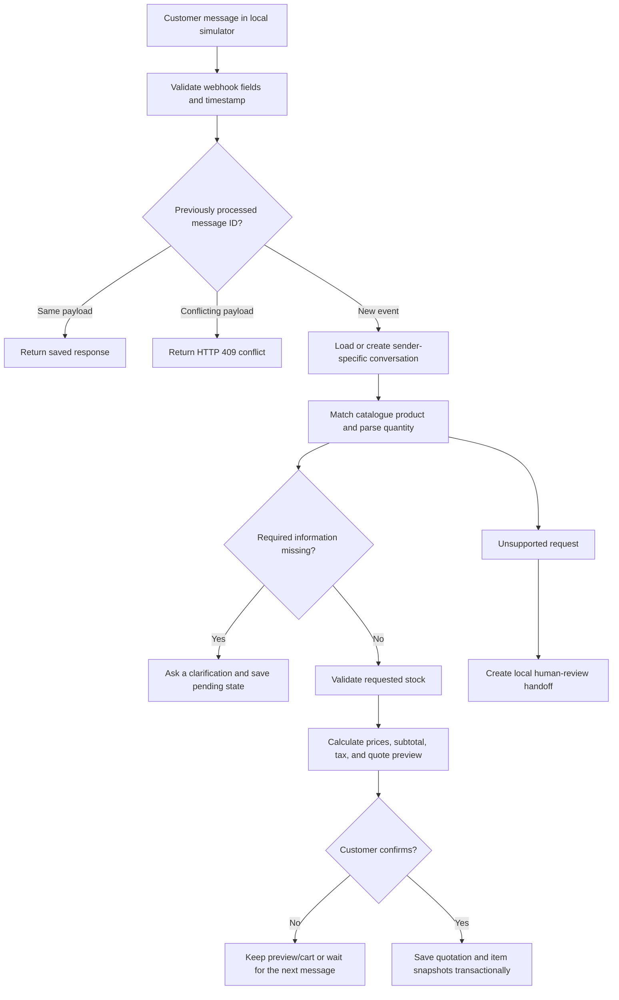

## Architecture and data storage

The React/Vite frontend makes JSON HTTP requests to the Express API. In development, Vite proxies `/api` requests to the backend at `http://127.0.0.1:3001`. The API validates simulated webhook events, processes sales intents, and reads or writes SQLite records. The backend is authoritative for catalogue prices, stock, and monetary totals.

Incoming simulated messages are posted to `POST /api/webhook/messages` (also available at `/api/webhook`). Each event has a sender ID, message ID, timezone-qualified ISO timestamp, and text. The message ID is used as an idempotency key; the backend stores a payload hash and the response in the same transaction as the message transcript and workflow effects.

| Tables | Purpose |
|---|---|
| `products` | Catalogue data, aliases, prices in integer paise, and stock |
| `conversations`, `carts`, `cart_items` | Sender-specific state and the current order |
| `messages`, `conversation_messages` | Incoming events, saved responses, and displayed transcript |
| `quotations`, `quotation_items` | Confirmed quotation totals and item/price snapshots |
| `handoffs`, `handoff_status_events` | Local review requests and auditable status changes |
| `schema_migrations` | Applied database schema versions |

The default database path is `backend/data/assistant.sqlite`. The application applies migrations when the database module is loaded. Run the seed command to ensure the catalogue records exist; existing records are preserved by the seed operation.

The API also exposes health, overview, product, conversation, quotation, handoff, and activity endpoints. The main read/write routes are:

| Method and path | Purpose |
|---|---|
| `GET /api/health` | API and database health |
| `GET /api/overview` | Current dashboard values and recent records |
| `GET /api/products` | Active product catalogue |
| `GET /api/conversations` | Searchable conversation inbox |
| `GET /api/conversations/:senderId` | One sender's transcript and current order context |
| `POST /api/conversations/:senderId/reset` | Clear only that sender's active cart and preview |
| `POST /api/webhook/messages` | Validate and process a simulated incoming event |
| `GET /api/quotations` | Confirmed quotation register |
| `GET /api/handoffs` and `PATCH /api/handoffs/:id` | Review and update handoff status |
| `GET /api/activity` | Saved message-processing activity |

## Installation and local execution

### Prerequisites

- Node.js 20 or newer and npm. The repository's CI workflow uses Node.js 20.
- A Windows, macOS, or Linux terminal.
- No API keys, WhatsApp account, or external service credentials are required.

There is no root `package.json`; install and run the backend and frontend from their respective directories.

### Install and seed

From the repository root, open a terminal and run:

```powershell
Set-Location backend
npm ci
npm run seed
```

`npm run seed` inserts the catalogue if it is missing and preserves existing catalogue records. Database migrations run automatically when the backend starts.

### Start the backend

If the terminal is still in `backend` from the install step:

```powershell
npm start
```

Alternatively, from a new terminal opened at the repository root:

```powershell
Set-Location backend
npm start
```

The API listens at `http://127.0.0.1:3001` by default. For development with Node's watch mode, use `npm run dev` instead.

### Start the frontend

In a second terminal:

```powershell
Set-Location frontend
npm ci
npm run dev
```

Open the local URL printed by Vite. The default is `http://localhost:5173`; if that port is busy, Vite selects another and prints it. Keep the backend and frontend terminals running while using the application.

The default development setup uses Vite's `/api` proxy, so a frontend API URL override is not needed. The backend can be configured through an optional `backend/.env` file; copy `backend/.env.example` as a starting point. Common settings are:

| Variable | Default | Purpose |
|---|---|---|
| `PORT` | `3001` | API port |
| `HOST` | `127.0.0.1` | API bind address |
| `FRONTEND_URL` | `http://localhost:5173` | Allowed development CORS origin |
| `DATABASE_PATH` | `./data/assistant.sqlite` | SQLite database file, relative to the backend |
| `TAX_RATE_BASIS_POINTS` | `1800` | Tax rate in basis points (18%); valid range is 0–10,000 |
| `LOG_LEVEL` | `info` | Pino log level |

For a production frontend build that calls a separately hosted API, set `VITE_API_URL` in the environment at build time. Do not put secrets in `VITE_*` variables because they become part of the browser bundle.

### Run tests and build

From the repository root:

```powershell
Set-Location backend
npm test
```

In another terminal:

```powershell
Set-Location frontend
npm run build
```

### Troubleshooting

- **Dashboard says the API is unavailable:** start the backend and check `http://127.0.0.1:3001/api/health`, then refresh the browser.
- **Port 3001 is already in use:** stop the other service or set a different backend `PORT`. If it changes, update the frontend API configuration/proxy target to match.
- **Vite reports that port 5173 is occupied:** use the alternate local URL printed by Vite. If using a non-default frontend origin with a separately configured backend, set `FRONTEND_URL` to that origin.
- **Catalogue appears empty:** from `backend`, run `npm run seed`, then refresh the page.

## Demonstration scenarios

The scenarios below were exercised during this documentation pass using the live local API and/or frontend against an isolated demo database. Automated test coverage is reported separately in [Testing evidence](#testing-evidence).

| Scenario | Input or action | Expected behaviour | Verified result |
|---|---|---|---|
| Multi-product quotation | `I need 2 keyboards, 3 monitors, and 1 mouse.` then `QUOTE` | Match all three products, check stock, and show itemized totals | Verified: subtotal ₹26,900.00; tax ₹4,842.00; total ₹31,742.00 |
| Missing quantity | `I need a keyboard.` | Ask for quantity and leave the cart unchanged until answered | Verified: asked “How many Mechanical Keyboards would you like?” |
| Insufficient stock | `12 monitors` | Report available stock and do not add the over-stock request | Verified: 10 monitors were available; request was rejected |
| Duplicate message event | Replay the same event ID and payload | Return the original response without applying side effects twice | Verified: first request was new; replay returned `replayed: true`; the UI cart remained at the result of one application |
| Two independent customer sessions | Add `1 mouse` for one sender and `2 keyboards` for another | Keep their conversations and cart lines separate | Verified: each sender's conversation and cart remained distinct |
| Confirmation and quotation creation | Confirm a displayed `QUOTE` preview | Save a quotation and item snapshots only after confirmation | Verified: confirmation returned a quotation ID; it appeared in the quotation register |
| Unsupported request and human handoff | `Can I get a custom bulk discount?` | Create a local handoff with context; do not claim a person was contacted | Verified: a handoff was added to the local queue; the reply said no employee was contacted |

## Testing evidence

I ran the repository's actual backend test and frontend build commands:

| Check | Command (run from) | Result |
|---|---|---|
| Backend tests | `Set-Location backend; npm test` | Passed: 16 tests, 0 failures |
| Production frontend build | `Set-Location frontend; npm run build` | Passed: Vite built the production bundle |

The backend tests cover catalogue data, fuzzy matching, missing and ambiguous information, multi-product totals, stock validation, confirmation and persistence, duplicate-event handling, sender isolation, handoff context and history, transactional rollback, concurrent duplicate requests, webhook validation, and overview/activity endpoints. These are Node.js `node:test` tests; the repository does not currently configure a separate coverage-report command.

## Limitations and future improvements

### Current limitations

- This is a local simulator, not a real WhatsApp integration. It does not send or receive messages through WhatsApp.
- Product and quantity handling is deterministic and limited to the implemented local parser and catalogue matching. Unrecognized or ambiguous language may need clarification.
- A handoff creates a local review record only; it does not notify or contact a sales employee.
- Stock is checked when a request is added and again when a quotation is confirmed, but stock is not reserved or decremented by a confirmed quotation.
- The staff interface has no authentication or authorization. It is not suitable for private customer data or production use.
- SQLite is intended for this single-process local demonstration, not shared storage for a horizontally scaled deployment.

### Possible future improvements

- Add a real WhatsApp Business integration with secure webhook verification and outbound-message handling.
- Add staff authentication, authorization, and notifications for handoff records.
- Add stock reservation and release rules around quotation confirmation.
- Expand language handling and add evaluation data for product/quantity extraction.
- Add a managed database, backups, monitoring, and deployment automation before any hosted production use.

## Deployment design

There is **no live deployment**. Azure is a proposal for a possible future deployment:

- Build the Vite frontend and host its static assets with Azure Static Web Apps or another static host.
- Run the Express backend on Azure App Service or Azure Container Apps behind HTTPS.
- Provide the frontend API URL at build time and configure the backend's port, bind host, CORS origin, tax rate, and log level in the hosting environment.
- Keep the current SQLite file on durable storage only for a single-instance demonstration. For a multi-instance production system, migrate to a managed relational database such as Azure Database for PostgreSQL.
- Use the existing GitHub Actions workflow for test/build checks. Add a separate protected deployment workflow only when Azure resources are configured.

No Azure resources or deployment URL have been created for this project.

## Conclusion

I built this project to demonstrate how product enquiries can be turned into a consistent, customer-specific quotation workflow. The application now supports a local message simulator, catalogue-backed matching and pricing, quantity and stock checks, customer confirmation, saved quotations, duplicate-event protection, and a local handoff queue. Building and testing it helped me connect a React interface to a validated API and persistent database while keeping financial calculations and customer state on the backend.
